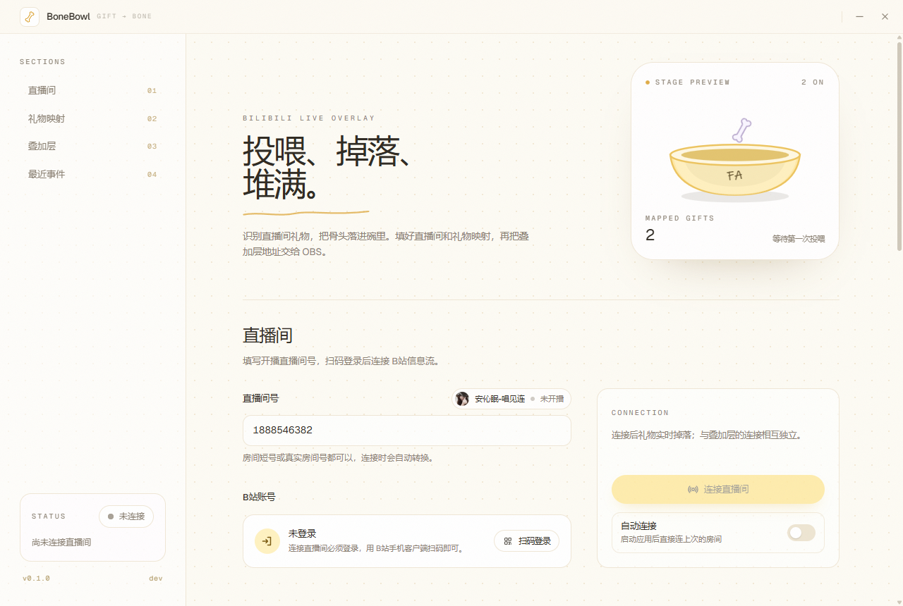
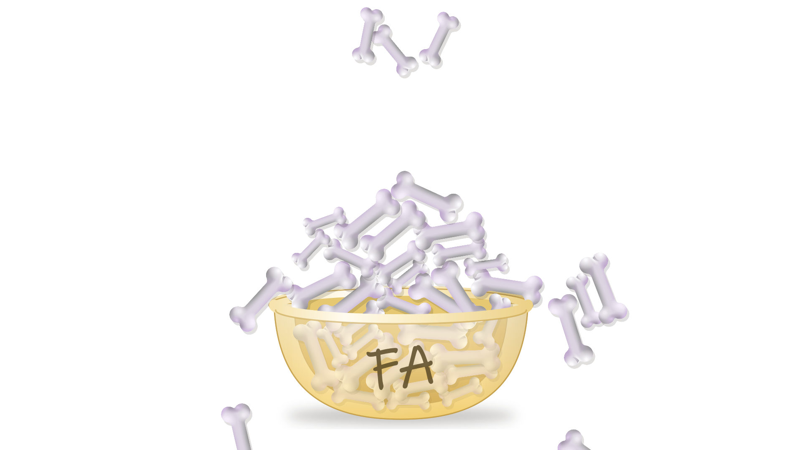

# BoneBowl

B站直播礼物驱动的骨头掉落叠加层。观众送礼，骨头掉进碗里，通过 OBS 浏览器源叠到直播画面。





## 功能

- 真实物理：PixiJS 渲染，Rapier2D 碰撞、堆叠、弹跳
- 扫码登录，Cookie 自动续期，失效时提示重新扫码
- 输入直播间号自动解析主播名、头像和开播状态
- 礼物映射按名称匹配，每条规则可调骨头数量和大小，支持试投
- OBS 透明叠加层，显示连接数和连接状态

## 开始

需要 Windows 10/11 和 Node.js 22+。

```bash
npm install
npm run dev
```

## 使用

1. 扫码登录 B站账号
2. 填写直播间号，点击「连接直播间」
3. 在「礼物映射」选择礼物，设置每份骨头数量和大小
4. 复制「OBS 浏览器源地址」，在 OBS 添加浏览器来源，宽高 1920 × 1080，勾选「场景激活时刷新浏览器」

页面背景透明，不需要色键，不要用窗口采集。直播期间保持应用运行，最小化不影响输出。

## 开发

```bash
npm run dev:web    # 浏览器预览，带模拟数据
npm run typecheck
npm run build
npm run dist       # 生成 NSIS 安装包到 release/
```

预览地址：

- 设置页 `http://localhost:5199/`
- 叠加层 `http://localhost:5199/overlay?test=1&debug=1`

`test=1` 自动投喂演示骨头，`debug=1` 显示调试信息，`lifetime=秒数` 覆盖消失时长。

Electron 二进制缺失时：

```bash
node node_modules/electron/install.js
```

## 配置

配置只保存在本机 `%APPDATA%\bonebowl\config.json`，修改自动保存，上一版备份到 `config.json.bak`。测试时可用 `BONEBOWL_CONFIG_PATH` 指向临时文件，避免覆盖真实配置。

## 技术栈

Electron、React、Tailwind CSS、PixiJS、Rapier2D。B站 Wbi 签名和信息流 WebSocket 为自实现，礼物支持 `SEND_GIFT_V2`（protobuf）和旧版 `SEND_GIFT`。

## 说明

B站接口并非官方公开 API，账号或协议可能因风控变化失效。实现参考 [bilibili-API-collect](https://github.com/SocialSisterYi/bilibili-API-collect)。
